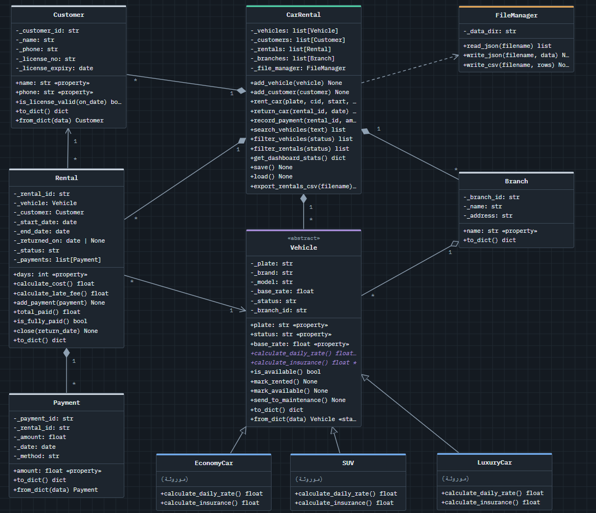

# Car Rental Management System

## Overview

The Car Rental Management System is a Python-based application designed to manage vehicles, customers, branches, rental operations, and payments.

The project applies Object-Oriented Programming (OOP) principles to organize the system into reusable, maintainable, and well-structured components.

## Features

- Manage different vehicle types: Economy Cars, SUVs, and Luxury Cars.
- Manage customer information and validate driving license expiration dates.
- Manage rental operations and vehicle availability.
- Calculate rental rates and insurance costs based on vehicle type.
- Manage branches and payment records.
- Validate user input and enforce business rules.
- Store and retrieve application data using file handling.
- Search and filter records.
- Handle invalid data and application errors.

## Technologies Used

- Python
- Object-Oriented Programming (OOP)
- JSON / File Handling (if used for data storage)
- Unit Testing

## Project Structure

```text
Car-Rental-System/
├── models/
│   ├── vehicle.py
│   ├── customer.py
│   ├── payment.py
│   ├── branch.py
│   └── rental.py
├── file_manager/
│   └── file_manager.py
├── services/
│   └── car_rental.py
├── gui/
│   └── app.py
├── tests/
├── main.py
└── README.md
```

## Requirements

- Python 3.x
- customtkinter

## Installation

1. Clone or download the repository.
2. Open the project directory.
3. Create and activate a virtual environment if needed.
4. Install the required dependencies, if any.

## How to Run

Run the following command from the project directory:

```bash
python main.py
```

## Testing

Run the tests using the test framework configured for the project.

For example, if the project uses pytest:

```bash
pytest
```

## Future Improvements

- Improve reporting and rental history management.
- Add more automated tests.
- Enhance the graphical user interface.
- Introduce database integration if required.

## Author

- Mahmoud Mostafa Mohammed 
- https://github.com/Maasry 
- Youssef Tarek Zakria
- https://github.com/youssseftarek

